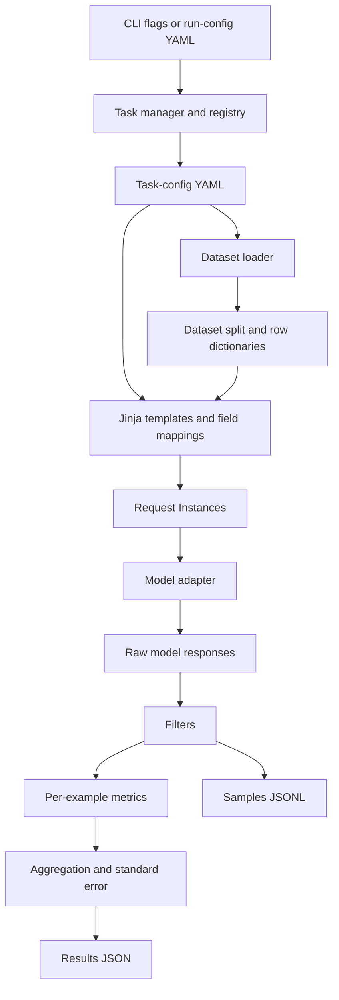

# `lm_eval` curriculum

The curriculum starts with the architecture of the harness and delays benchmark execution until every input and output has a clear role.

## [Milestone 1: Harness mental model](milestone-01-harness-mental-model.md)

**Question:** What problem does an evaluation harness solve?

Learn the difference between a model, model adapter, dataset, task, request, response, filter, metric, aggregation, and evaluation run. Separate the benchmark definition from the software that executes it.

**Complete when:** You can describe the evaluation lifecycle in your own words without referring to PIQA or another specific benchmark.

## [Milestone 2: Source-code orientation](milestone-02-source-orientation.md)

**Question:** Where does each part of the harness live?

Clone the official repository at the same version used by this project. Locate the CLI, task registry, task definitions, model adapters, request abstractions, evaluator, filters, metrics, loggers, and tests. Trace the CLI entry point to the evaluator without studying implementation details yet.

**Complete when:** Given a component name, you can locate its source folder and state its responsibility.

## [Milestone 3: Component architecture and file formats](milestone-03-component-architecture.md)

**Question:** How do the components communicate, and what representation crosses each boundary?

Study the harness one level above any particular benchmark. Follow configuration and data from the command line to the saved result.

### Components and representations

| Component | Responsibility | Main representation |
|---|---|---|
| CLI and run configuration | Select the model, tasks, runtime settings, seeds, cache, and output location | Shell arguments or a run-config `.yaml` file |
| Task manager and task index | Discover task, group, and tag names from built-in and externally included task definitions | Python index built by scanning task YAML files |
| Component registries | Resolve model adapters, filters, metrics, and aggregations by their registered aliases | Python decorators and registry dictionaries |
| Dataset loader | Download or open examples and expose named splits such as `train`, `validation`, and `test` | Hugging Face `Dataset`; source data commonly Parquet, JSON/JSONL, or CSV; local processed cache uses Arrow |
| Task configuration | Declare which dataset and split to use, how to create prompts and targets, the request type, few-shot behavior, filters, and metrics | Task-config `.yaml` file |
| Template and mapping layer | Transform one dataset row into the prompt, answer choices, and reference target | Jinja expressions or dataset-field mappings in YAML; Python functions for transformations YAML cannot express cleanly |
| Task object | Combine the declarative configuration with task behavior and iterate over examples | Python `Task` or `ConfigurableTask` object |
| Request builder | Convert a rendered example into one or more operations the model adapter understands | In-memory Python `Instance` objects such as `loglikelihood`, `loglikelihood_rolling`, or `generate_until` |
| Model adapter | Translate harness requests into calls to Hugging Face, vLLM, an API, or another inference backend | Python adapter implementing the harness model interface |
| Filter pipeline | Extract or transform raw model responses before grading | Filter names and arguments in YAML backed by registered Python functions/classes |
| Metric | Grade one filtered response against its reference answer | Per-example numbers or structured values; metric selected in YAML and implemented in Python |
| Aggregator | Combine per-example values and estimate uncertainty | Mean or another registered aggregation plus standard error |
| Evaluation tracker | Record configuration, aggregate results, prompts, responses, and per-example grades | Aggregate `.json` and optional sample `.jsonl` files |
| Caches | Avoid repeatedly downloading assets, rebuilding requests, or calling models | Hugging Face model/dataset files, Arrow datasets, serialized request caches, and optional SQLite model-response caches |

### Why YAML and Python both exist

YAML is the declarative wiring layer. It is appropriate for selecting a dataset, naming its splits, defining prompt mappings, choosing request types, and attaching standard metrics. Jinja inside YAML renders fields from each dataset row into text.

Python is the behavior and extension layer. It loads models, constructs requests, performs inference, implements metrics and filters, and handles transformations that cannot be represented clearly in YAML. A custom task can remain YAML-only when the dataset shape, prompt transformation, and grading logic all use existing components.

### Files to recognize

| File | Meaning |
|---|---|
| `*.yaml` | A task/group definition or a whole-run configuration |
| `*.py` | Harness implementation or a custom model, task helper, metric, filter, or aggregation |
| `*.parquet`, `*.json`, `*.jsonl`, `*.csv` | Possible source dataset formats |
| `*.arrow` | Hugging Face Datasets' processed local cache |
| `results_*.json` | Run-level configuration and aggregate metrics |
| `samples_*.jsonl` | One evaluation sample per line, including prompts, responses, and grades |
| `*.pickle` | Serialized request cache |
| `*.db` | Optional SQLite model-response cache |

**Complete when:** Starting from a run command, you can draw the path to `results_*.json`; state which steps are configuration, in-memory Python objects, or persisted files; and explain when a custom evaluation needs Python in addition to YAML.

## [Milestone 4: Task anatomy](milestone-04-task-anatomy.md)

**Question:** How does one benchmark become an executable task?

Trace one PIQA dataset row through its YAML fields: dataset path, split, `doc_to_text`, `doc_to_choice`, `doc_to_target`, output type, filters, and metrics. Render its exact prompts by hand.

**Complete when:** You can start with an untouched dataset row and predict every model request the task will construct.

## [Milestone 5: Model requests and scoring](milestone-05-model-requests-and-scoring.md)

**Question:** What operation does the model perform, and how does that become a grade?

Study `loglikelihood`, `loglikelihood_rolling`, and `generate_until`. Manually score one multiple-choice example and distinguish total, normalized, and exact-match metrics.

**Complete when:** You can explain why a task creates one request per choice and calculate the selected answer from model outputs.

## [Milestone 6: First controlled run](milestone-06-first-controlled-run.md)

**Question:** Can we execute and reproduce the pipeline?

Run a small benchmark with a pinned harness, model, task, seeds, and runtime configuration. Save both aggregate and sample outputs. The existing Pythia-14M PIQA run becomes the worked example here.

**Complete when:** You can rerun the evaluation and account for every generated artifact.

## [Milestone 7: Reading results](milestone-07-reading-results.md)

**Question:** What does the score establish, and what does it leave uncertain?

Interpret aggregate metrics, per-sample grades, standard error, effective sample size, configuration metadata, and failure slices. Learn why identical aggregate scores can hide different behavior.

**Complete when:** You can investigate a failure from its aggregate signal down to its prompt, model response, and grading decision.

## [Milestone 8: Controlled experiments](milestone-08-controlled-experiments.md)

**Question:** How do we make a fair comparison?

Compare model sizes, zero-shot and few-shot prompting, and demonstration-selection seeds while changing one variable at a time. Track cost, latency, uncertainty, and configuration differences. The chat-template comparison follows in Milestone 9, where an instruction-tuned model makes that factor meaningful.

**Complete when:** You can defend whether a measured difference is attributable to the intended experimental change.

## [Milestone 9: Custom evaluation](milestone-09-custom-evaluation.md)

**Question:** How do we turn our own product requirement into an eval?

Create a customer-support task with development, regression, and final-test cases. Begin with existing YAML components, then add a Python helper or metric only when the task requires it.

**Complete when:** `lm_eval` can discover, validate, run, and score the custom task without editing the installed package.

## [Milestone 10: Reproducible evaluation workflow](milestone-10-reproducible-evaluation.md)

**Question:** Can another person audit and repeat the experiment?

Version task definitions and datasets, use run configurations, preserve sample logs, manage caches, check for contamination, and automate regression evaluation.

**Complete when:** A clean checkout can reproduce the evaluation and explain any permitted sources of variation.
