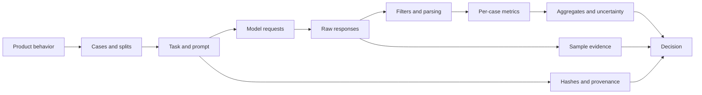

# `lm_eval` course recap: Milestones 1–10

The course builds one idea in layers: an evaluation is a controlled experiment,
not a single score. A defensible result connects a declared behavior to fixed
cases, an exact inference procedure, explicit grading, preserved evidence, and a
claim no broader than the data supports.



## What each milestone taught

| Milestone | Main lesson | Design pattern retained |
|---|---|---|
| 1. Harness mental model | A dataset, task, model adapter, request, response, filter, metric, aggregation, and run are separate objects. One case can create several requests. | Define the system, cases, procedure, grading, and aggregation independently. |
| 2. Source orientation | `lm-eval run` travels through the CLI, evaluator, task registry, request builder, model adapter, metrics, and result tracker. | Trace ownership in source before changing behavior. |
| 3. Components and formats | Run YAML selects an experiment; task YAML defines example behavior; Jinja maps rows; Python extends behavior; JSON/JSONL preserves outputs. | Make every boundary and representation inspectable. |
| 4. Task anatomy | `doc_to_text`, `doc_to_choice`, and `doc_to_target` turn a PIQA row into prompts, candidates, and a hidden reference. | Derive the exact requests from a raw row before trusting a score. |
| 5. Requests and scoring | `loglikelihood`, `loglikelihood_rolling`, and `generate_until` measure different behaviors. `acc`, `acc_norm`, and `exact_match` answer different questions. | Match the model operation and metric to the behavior users need. |
| 6. First controlled run | Twenty two-choice cases make 40 likelihood requests, 20 predictions, and 20 grades. Aggregate JSON and sample JSONL serve different purposes. | Pin the protocol and preserve both summary and per-case evidence. |
| 7. Reading results | A point estimate needs effective sample size, standard error, slices, and failure inspection. Equal aggregates can hide different decisions. | Move from aggregate signal to concrete failures before drawing a conclusion. |
| 8. Controlled experiments | Zero-shot/five-shot, few-shot seeds, and model size were compared while other inputs stayed fixed. | Change one factor at a time; use paired case transitions and uncertainty. |
| 9. Custom evaluation | A customer-support requirement became an external YAML/Python task with structured tool calls, three data splits, and five diagnostic metrics. | Turn product contracts into layered, actionable grades before choosing models. |
| 10. Reproducible workflow | Git, a lockfile, immutable model revisions, manifests, baselines, clean-tree checks, fresh inference, sample-level recomputation, and a clean clone define an auditable run. | Treat reproducibility and holdout governance as part of evaluation design. |

## The evaluation object model

The most important vocabulary is:

- A **dataset row** is source material: inputs, references, metadata, and slice
  labels.
- A **task** turns that row into the operation to perform and the rule for
  grading it.
- An **Instance** is one concrete model request. A multiple-choice case creates
  one likelihood Instance per choice; a generative case usually creates one
  generation Instance.
- A **model adapter** translates standard harness requests into backend-specific
  inference calls.
- A **raw response** is what the adapter returns. A **filtered response** is the
  value the metric actually receives.
- A **metric** grades one case. An **aggregation** combines case grades. Standard
  error describes uncertainty in that aggregate.
- A **result JSON** describes the run and its aggregates. A **sample JSONL**
  preserves prompts, responses, references, hashes, and per-case grades.

Keeping these objects separate prevents a common error: treating “the model
score” as if it were a property of the model alone. The score belongs to the
complete model-plus-protocol combination.

## Likelihood and generation are different protocols

For multiple-choice likelihood scoring, the harness supplies the prompt as
context and each candidate as a continuation. The causal mask lets the model
score every continuation token against only the tokens before it. The harness
sums those token log probabilities, chooses the highest-scoring candidate, and
compares its index with the hidden label. The model is not asked to print `A`,
`B`, `C`, or `D`.

For generative scoring, the model receives the prompt and produces text. A
filter may extract or normalize that text before a metric such as exact match or
a custom structured-output scorer grades it. This protocol often better matches
an assistant whose production job is to emit an answer or tool call.

Neither protocol is universally better. The protocol should represent the
behavior the evaluation claims to measure.

## Data lifecycle

| Split | Purpose | Feedback rule |
|---|---|---|
| Development | Build and debug the prompt, parser, scorer, and model choice | Inspect freely and iterate |
| Regression | Protect behaviors already fixed, especially production failures | Run routinely; add a case after the failure is understood |
| Final test | Estimate performance after decisions are frozen | Run only at a predeclared gate; do not tune from the outcome |

A final set is “golden” only if a team uses that word for an approved reference
set; the term is ambiguous. The operational rules above matter more than the
name. Development cases can later become regression cases when they represent a
behavior worth permanently protecting. They should not be copied into the final
test, because that would make the final estimate partly measure familiar cases.

## Layered metrics for structured output

The customer-support exercise used a strict release metric plus diagnostic
metrics:

1. `valid_json`: could the text be parsed?
2. `valid_tool_schema`: was it a permitted call with valid names and types?
3. `correct_tool`: did the model choose the right action?
4. `correct_arguments`: did it extract every required value exactly?
5. `exact_tool_call`: did the complete call match the reference?

This pattern makes a low score actionable. A model can choose the right tool but
format invalid JSON, or produce valid structure with the wrong quantity. One
exact-match number would reveal that something failed but not what to fix.

## Fair experiments

A comparison is interpretable when the intended factor changes and the rest of
the protocol remains fixed. Record at least:

- model repository, immutable revision, adapter, tokenizer, and dtype;
- prompt/task version, chat-template behavior, few-shot count and selected
  demonstrations;
- generation settings, batch size, device, limits, and all random seeds;
- exact case membership and scorer/filter code;
- latency or token cost when the decision depends on operational tradeoffs.

Compare paired per-case outcomes in addition to means. If two models both score
60%, one may fix three old failures while breaking three old successes. Those
systems have equal aggregates and different risk.

## Evidence, identity, and caches

The reproducible identity used in Milestone 10 is:

```text
source commit
+ locked dependencies
+ immutable model revision
+ task, prompt, scorer, and dataset hashes
+ runtime configuration and seeds
= declared evaluation identity
```

Hashes show whether declared inputs changed. They do not explain model behavior;
sample logs do that. A baseline states the minimum acceptable behavior. A clean
tree prevents uncommitted source from masquerading as a recorded commit. A clean
checkout proves setup does not secretly depend on the course author's environment.

Download and preprocessing caches are disposable speedups. A response cache can
be useful during development, but a release or regression evidence run should
perform fresh inference. Deleting a cache may increase time or require network
access; it should not alter the declared experiment.

## Holdouts and contamination

Training contamination and development contamination are different:

- **Training contamination** occurs when model training includes evaluation
  cases or close variants. Scores may reflect memorization. Proving absence
  generally requires relevant training-corpus access; a task flag or hash cannot
  establish it by itself.
- **Development contamination** occurs when people inspect holdout examples or
  results and adapt the system to them. Access controls and a release-only
  process reduce this risk.

This tutorial's final cases remain unscored and are not loaded by routine
commands. They are committed for learning and therefore are not blind. A
production final set should live in restricted storage and be fetched only by
the release evaluator.

## A reusable checklist for a new evaluation

1. Write the user-visible behavior and the decision the score will inform.
2. Define the evaluation population, important slices, and failure costs.
3. Create separate development, regression, and final-test case sets.
4. Render several raw rows by hand into their exact prompts, candidates, and
   references.
5. Choose likelihood or generation according to the production behavior.
6. Add one strict success metric and diagnostic metrics that localize failure.
7. Test the scorer with exact, malformed, partial, and semantically wrong
   outputs.
8. Pin the full protocol and save aggregate plus per-sample evidence.
9. Compare changes on the same cases, one declared factor at a time.
10. Automate regression thresholds, provenance checks, and clean-environment
    reproduction before using a final holdout.

## What the course result does and does not establish

The project demonstrates that a pinned local Qwen configuration can reproduce
the accepted five-case customer-support regression result and that the complete
workflow can be audited from source. It does not establish production quality:
the datasets are deliberately tiny, the tools are represented as text rather
than executed, and the final holdout has not been run.
